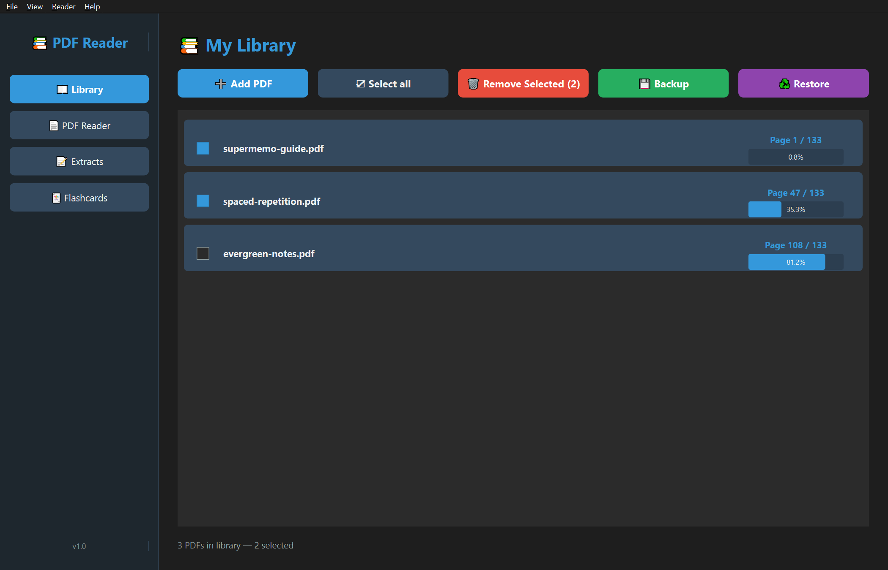
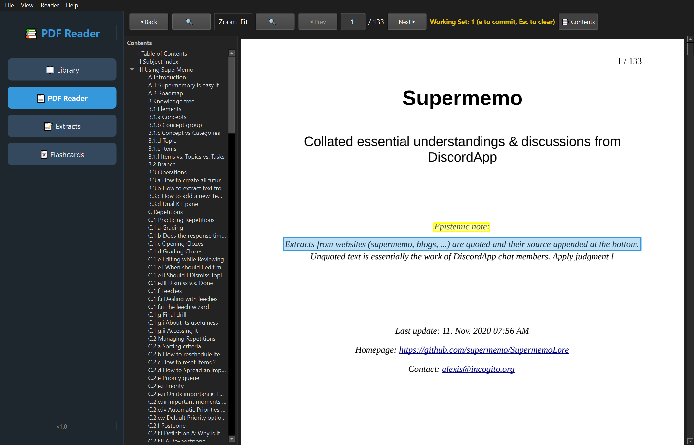
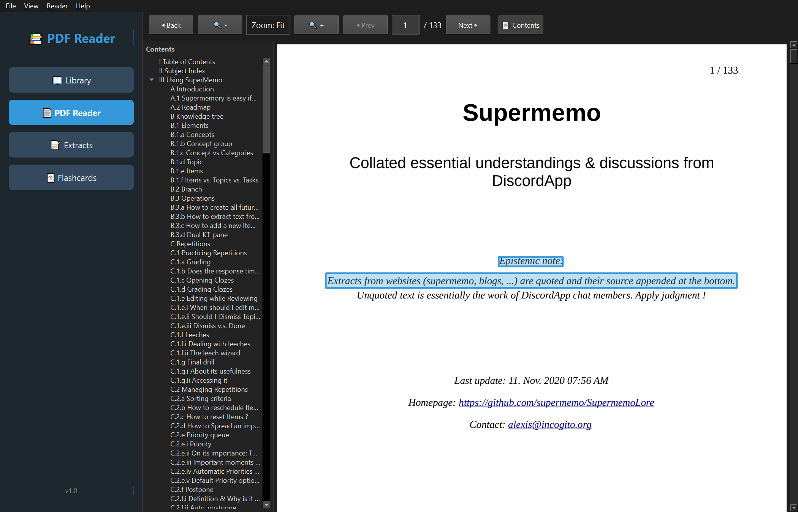
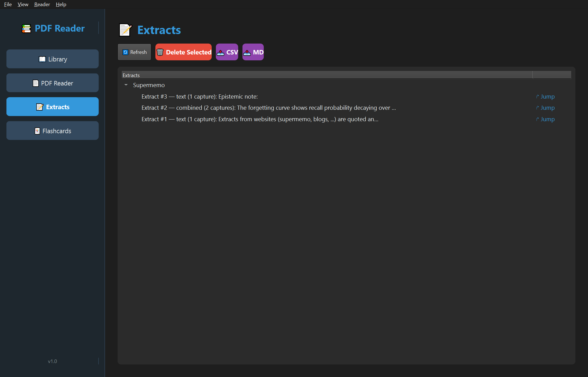
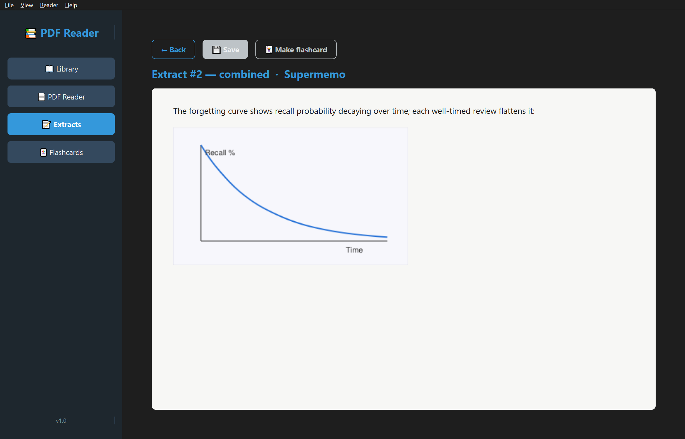
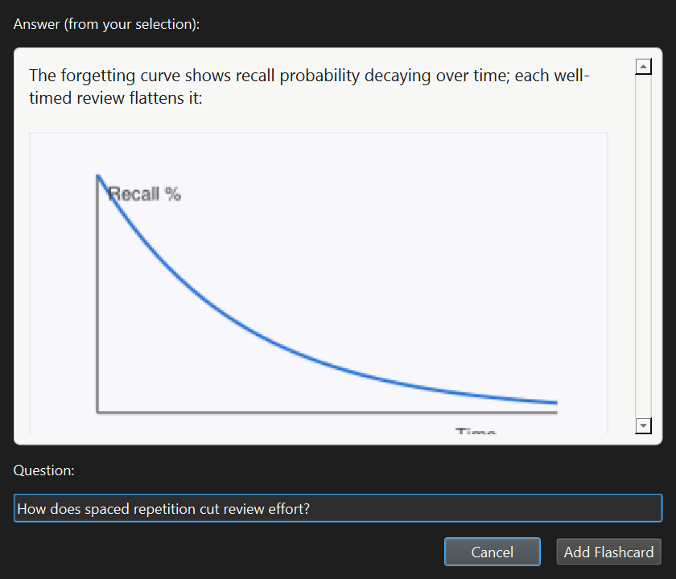
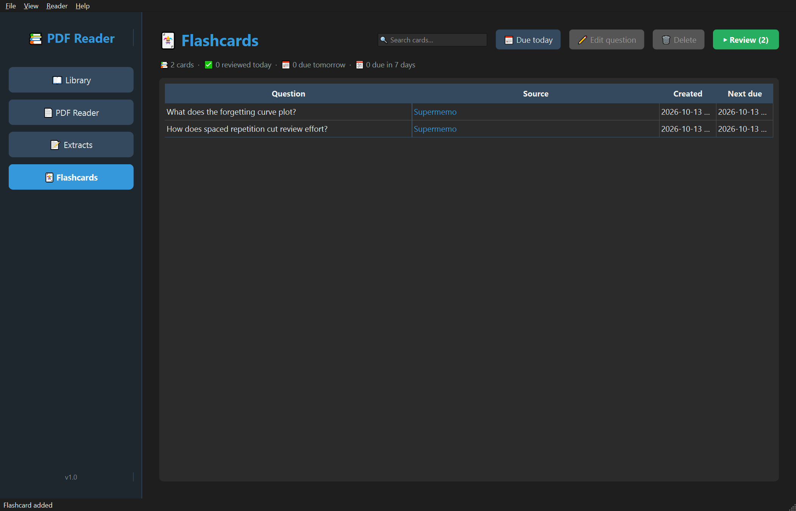

# PDF Reader

A desktop PDF reader for studying: read documents in a keyboard-driven reader, extract highlights into notes, and review them later.

It helps people who read PDFs for learning — course materials, papers, and technical docs:

- Select text (drag) or an image (click), press `e` — it becomes a permanent Extract.
- Review, edit, and jump back to your extracts anytime; they survive restarts.
- Turn any passage into a flashcard and drill it with spaced repetition (FSRS, like Anki).

**New here? Start with the [How to Use guide](HOW_TO_USE.md)** — a guided, example-driven tour of every feature.

## Demo

The reader:

- Open a PDF from the library (double-click a row); read progress is remembered per file
- Navigate with Vim-style keys (`j`/`k`, `gg`/`G`, `Space`), search with `/`, zoom with `+`/`-`

Capture workflow:

- Drag over text (or click an image) — it lights up **yellow** (pending)
- Stack non-contiguous selections; they all commit together
- Press `e` — saved as one **blue Extract** (survives restarts, stored in `library.db`)
- Press `Esc` — discard the pending set without saving
- Press `d` `d` — delete the newest Extract on the current page
- **📝 Extracts view** — browse and delete every extract, grouped by document
- Open an extract (`Enter` / double-click) in the full-area editor: text and inline images in one document; **💾 Save**, or **← Back** (auto-saves)
- **↱ Jump** — reopens the reader centered on the original region, with a brief orange flash

## Screenshots

**Library** — your PDFs, read progress, bulk remove, one-click backup



**Capture** — drag over text, it lights up yellow (pending)



**Extract** — press `e` and the yellow is saved in blue, forever



**Extracts view** — every capture, organized by document



**Extract editor** — text and images together in one continuous document



**Make a flashcard** — turn any selected passage into a question



**Flashcards** — due-today filter and spaced-repetition review (FSRS)



## Problem

- People who study from PDFs want to remember what they read, but most readers make capturing notes a side task with its own workflow.
- Extracting an interesting figure, a quote, or a formula usually means a second application (copy, switch windows, paste into notes) or a separate annotation layer that is hard to browse afterwards.
- Generic note tools lose the link to the source page; PDF-native tools bury the notes inside the document.

This project is a study workflow: select, extract, review — in one place, keyboard-first, without leaving the reader.

## Evaluation

The snappiness round (#87–#94, PRs #90–#96) diagnosed, fixed and measured scroll, open, Back and reopen with an opt-in timing log (`PDFR_DEBUG_PERF=1` or a `perf.enabled` marker file → console + `pdf_reader/gui_app/perf.log`):

- Cold open: 756 → ~290 ms
- Same-file reopen: ~400+ → ~5 ms
- Back click → first paint: ~8–11 ms (dev machine)
- Every Back click records its real latency in `perf.log` (`back: click -> library first paint`)

## Testing

The seams in `gui_app/services/` and the offscreen-capable Qt views have a pytest suite (**295 tests**):

- SQL seams — extract/capture/flashcard + DB backup against a temp SQLite DB
- Layout math, editor-selection snapshots, the FSRS scheduler
- Review-session loop, card-list and due-filter behavior
- Extracts-view jump landing; library-list UX (checkbox removal, backup, rebuild-skip)
- Reader search keys + open/reopen seams (extract load once, fast-reopen identity)
- Tree/flashcard label helpers

CI (`.github/workflows/tests.yml`) runs the whole suite on every push to `master` and every PR (ubuntu-latest, Python 3.12, `QT_QPA_PLATFORM=offscreen`, #81).

```powershell
cd pdf_reader/gui_app
$env:PYTHONNOUSERSITE="1"; & "D:\volume\tempprograms\anaconda\envs\pdf-reader-clean\Scripts\pytest.exe" tests/
```

Deps: `pytest` is in `requirements-dev.txt`. Still verified by hand (no widget tests):

- Reader core against `pdf_reader/pdfs/test.pdf`: drag → `e` → blue, `Esc`, blue re-draw on reopen, image click-capture, `d`-twice delete, ↱ Jump centering
- Extracts list/delete flow; the editor's type → 💾 Save → ← Back loop

pytest does cover the reader's search keys/highlight and its open/reopen seams, and the Extracts view's `open_extract` jump landing.

## Monitoring

Not applicable — the app runs locally with no external services. Usage data (read progress, extracts) is stored in a local SQLite database (`pdf_reader/gui_app/library.db`).

## Quickstart

Prerequisites:

- Python 3.11+
- Conda or another environment manager (recommended)
- The dependencies in `requirements.txt` (`PyQt6`, `pymupdf`)

Install:

```bash
pip install -r requirements.txt
```

Run:

```powershell
.\run.ps1
```

`run.ps1` and `dev.ps1` pick the `pdf-reader-clean` conda environment's Python automatically. `dev.ps1` watches the `gui_app/` sources and auto-restarts the app on every save — use it while developing.

Manual run (imports are flat, so run from the `gui_app/` directory):

```powershell
cd pdf_reader/gui_app
python main.py
```

## Data and configuration

No environment variables or API keys are required. The app creates `pdf_reader/gui_app/library.db` (SQLite) on first run to store library entries, per-file read progress, and extracted notes (`extracts` + `captures` tables).

`test.pdf` in `pdf_reader/pdfs/` is a sample document for trying the reader without hunting for a PDF.

## Deployment

Not deployed — it is a local desktop application. For running it **without a Python environment**, the repo ships a PyInstaller build (#118):

### Running without Python (standalone build)

Build steps (Windows, from the repo root):

```powershell
# 1. One-time: install deps + PyInstaller into the app's environment
pip install -r requirements.txt -r requirements-dev.txt

# 2. Build + smoke-check in one command (produces dist/pdf_reader/pdf_reader.exe)
.\build.ps1

# 3. Run it
.\dist\pdf_reader\pdf_reader.exe
```

`build.ps1` runs PyInstaller and then launches the exe for a few seconds to confirm it starts (a missing bundled Qt plugin or sqlite DLL shows up as an early exit). Pass `-NoCheck` to skip the smoke check. The manual equivalent is `python -m PyInstaller --noconfirm pdf_reader.spec` (~1-2 min).

CI also builds this on every push/PR (a separate `windows-latest` job in `.github/workflows/tests.yml`) and uploads the `dist/pdf_reader/` folder as the `pdf-reader-windows` artifact, so a packaging break fails the build instead of rotting until someone runs it by hand.

Notes:

- The spec (`pdf_reader.spec`) collects QtPdf (`PyQt6.QtPdf` — PyInstaller's static analysis doesn't always trace it) and PyMuPDF submodules; windowed (`console=False`) build.
- In the built app, `library.db` and `backups/` live **next to `pdf_reader.exe`** (not inside `_internal/`, which an upgrade replaces).
- Distribute the whole `dist/pdf_reader/` folder — the exe is not self-contained in one file. Zipping that folder is the simplest way to share it.
- No installer or code signing yet; this is a manual build. CI builds and smoke-checks the exe but does not produce a signed installer.

## Architecture

```
MainWindow
│  (sidebar + view stack)
├── LibraryView       lists documents, opens a PDF
├── PdfReaderView     QPdfView-based reader (keys, search, page progress, extraction)
├── ExtractsView      Documents → Extracts → Captures review + edit + delete
└── FlashcardsView    card list + FSRS review session: Review (n) → question → reveal → grade 1-4 (Again re-queues, summary)

services/             headless seams (SQL, layout math, scheduler, exports, perf) + image click-capture
services/extract_store.py   headless extract/capture/flashcard SQL seam (no Qt), pytest-tested
services/selection_snapshot.py  editor selection → answer snapshot seam (offscreen Qt), pytest-tested
services/fsrs_scheduler.py  FSRS scheduling seam over the pinned `fsrs` lib (fuzz on in app, off in tests), pytest-tested
services/pdf_geometry.py    layout/mapping math mirroring Qt's calculateDocumentLayout
```

- Pages render through QtPdf (`QPdfView`)
- PyMuPDF handles text search, image element detection (click-capture), and image blob rendering
- `QPdfDocument.getSelection` supplies the text payload for drag-captures
- Highlight rects come from a Qt-mirroring layout model (`pdf_geometry.py`), so yellow/blue stay aligned with the rendered page

## Project structure

```
pdf_reader/
├── requirements.txt          pinned runtime dependencies
├── requirements-dev.txt      dev/test deps (pytest)
├── run.ps1 / dev.ps1         run once / auto-restart while developing
├── build.ps1                 one-command PyInstaller build + smoke-check
├── CONTEXT.md                domain vocabulary for the extract feature
├── docs/images/              screenshots for this README and HOW_TO_USE.md
├── pdf_reader/
│   ├── gui_app/
│   │   ├── main.py           entry point
│   │   ├── main_window.py    sidebar + view routing
│   │   ├── services/
│   │   │   ├── extract_store.py   headless extract/capture/flashcard SQL seam (no Qt)
│   │   │   ├── selection_snapshot.py  editor selection → answer snapshot (offscreen Qt)
│   │   │   ├── fsrs_scheduler.py  FSRS scheduling over the pinned `fsrs` lib
│   │   │   ├── pdf_geometry.py    Qt-mirroring layout/mapping math
│   │   │   ├── export_data.py     CSV/Markdown export builders
│   │   │   ├── perf_log.py        opt-in timing log (perf.enabled / PDFR_DEBUG_PERF)
│   │   │   └── element_detector.py  image click-capture in the reader
│   │   ├── tests/            pytest — full suite in AGENTS.md's Testing section (seams + offscreen Qt views)
│   │   └── views/
│   │       ├── library_view.py
│   │       ├── pdf_reader_view.py   the core reader
│   │       ├── extracts_view.py     Documents → Extracts → Captures + edit + delete
│   │       └── flashcards_view.py   card list + FSRS review session
│   └── pdfs/test.pdf         sample document
```

## Decisions and trade-offs

- **PyQt6 over Tkinter / a web app** — native desktop widgets and QtPdf integration; accepted cost: a heavier dependency.
- **QtPdf for page rendering + PyMuPDF for search/extraction** — best of both: native rendering with fast text searching via PyMuPDF's page-space rects.
- **SQLite for storage** — no server, single file, adequate for a local single-user app.
- **Flat imports in `gui_app/`** — the app currently runs from `gui_app/` rather than as an installed package; keeps the entry point trivial at the cost of a less conventional import style.

## CI/CD

- Git-only development: feature branches → PR → merge (no release automation)
- CI (`.github/workflows/tests.yml`, #81): pytest suite offscreen on ubuntu-latest, every push to `master` and every PR
- CI also builds the Windows exe, smoke-checks it, and uploads the `pdf-reader-windows` artifact (#118)
- No CD: nothing is auto-released or deployed; a lint job on top of CI is still planned

## Limitations

- The core reader view (`pdf_reader_view.py`) is mostly verified by hand (drag→`e`→blue, image click-capture, `d`-twice delete); pytest covers its search keys/highlight (`test_pdf_search.py`) and its open/reopen seams (`test_highlight_refresh.py`)
- Right-click context menus are manual-only: offscreen Qt (CI) cannot deliver them
- Re-highlighting already-extracted (blue) content is refused with a status hint — per the domain rule "yellow is never drawn over blue".
- No installer yet — the standalone build (#118) is a PyInstaller folder (`dist/pdf_reader/`) you build with `.\build.ps1`; CI builds and smoke-checks it on every push/PR. The dev workflow still requires a Python environment.

## Future work

Shipped along the way (kept for the rubric trail):

- Flashcards + FSRS review session, due-today filter, source jumps (#54–#63)
- PyInstaller build + CI exe artifact (#118)
- One-click `library.db` backup (#83)

Still open:

- Installer + code signing for the standalone build
- Lint job on top of the existing CI

## Self-evaluation

This is a learning project (AI Dev Zoomcamp), checked against the course rubric:

- Problem statement — covered (above)
- Implementation — full capture workflow shipped (drag/click → `e` → blue, `d`-twice, Extracts view, editor, jump-back); flashcards + FSRS shipped
- Testing — seams and offscreen-capable views pytest-covered (**295 tests** + CI); the core reader is verified by hand
- Monitoring — not applicable (local app); gaps documented above rather than hidden

---

## How this README was built

Follows the 16-section guidance from Alexey Grigorev's [How to Write a Good README](https://aishippingblog.com/p/how-to-write-a-good-readme). Sections that don't fully apply (e.g. monitoring) are stated honestly instead of omitted, per the article's advice.